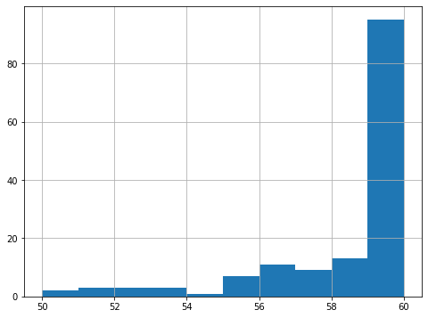

# English Text Summarization

A collection of abstractive text-summarization experiments using **BART, PEGASUS, T5, and CNN/DailyMail-style data**, with evaluation based primarily on ROUGE and BLEU metrics.

## What is included

- Fine-tuning/evaluation notebooks for BART and PEGASUS.
- T5 preprocessing, training, and evaluation workflow.
- CNN/DailyMail experiments.
- Separate notebooks for comparing generated summaries and evaluation metrics.

## Results

Saved outputs include ROUGE evaluations for multiple models. For example, one BART experiment records a ROUGE-1 mid F-measure of approximately **0.477**, while later comparison notebooks report ROUGE-1 values around **0.48**.

## Data

The ZIP includes `news_summary - train.csv` and `news_summary - test.csv`. Some notebooks additionally download Hugging Face datasets or expect generated files such as `bart.csv`, `t5.csv`, and `pegasus.csv`.

## Run

A GPU-enabled Colab runtime is recommended. Install the Hugging Face Transformers/Datasets stack plus the notebook-specific fastai/blurr dependencies before training.

> Reproducibility note: `cnndm2.ipynb` expects a `cnndm.zip` file in Google Drive, and the performance notebooks expect model-output CSV files that are not included in the uploaded ZIP.
